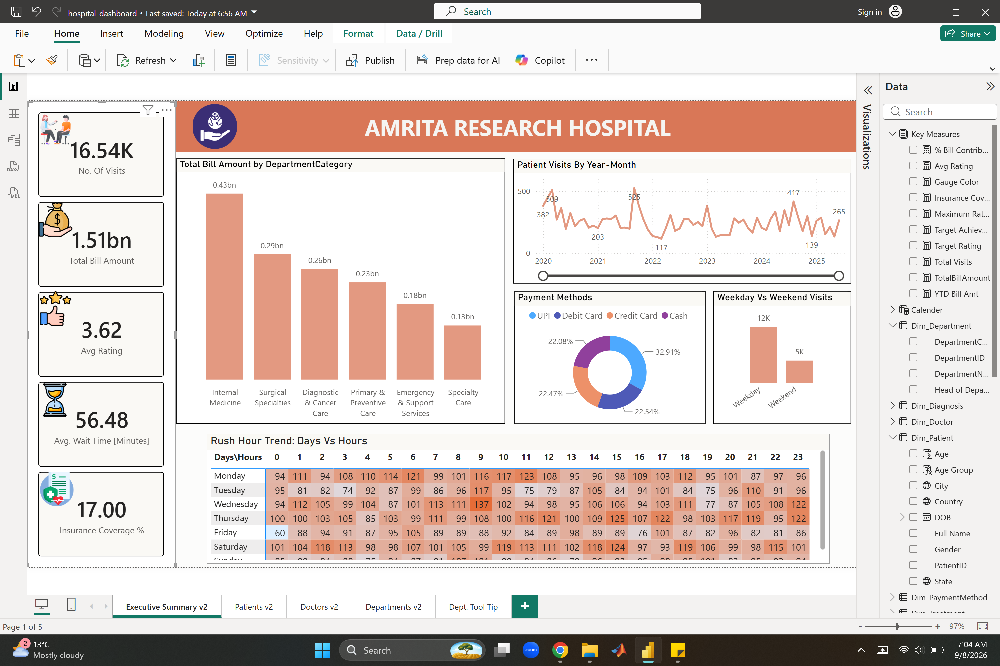
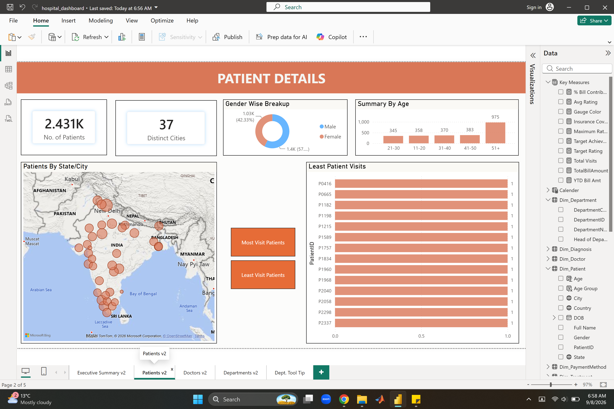
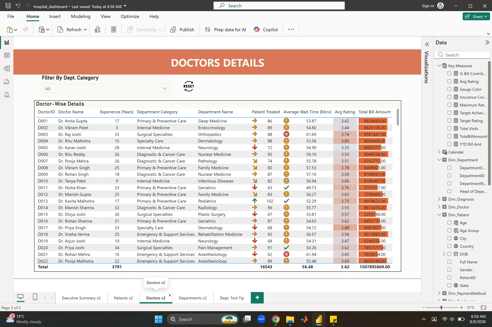
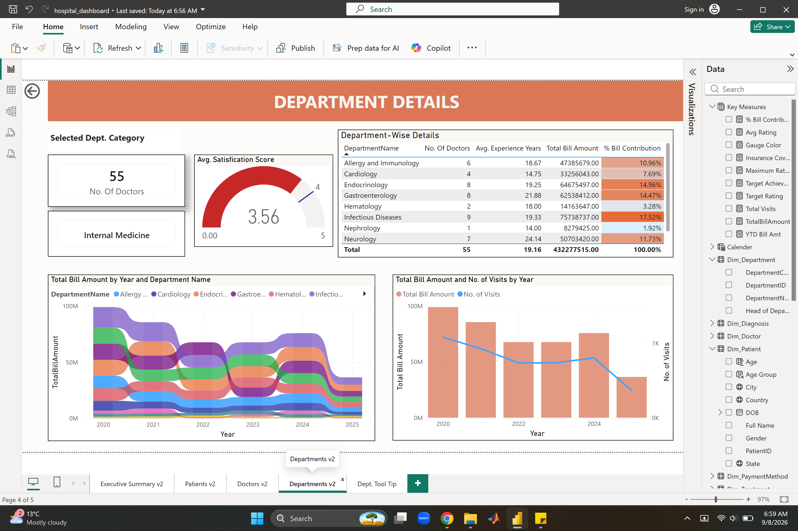

# Power BI — hospital dashboard

Report file: [`hospital_dashboard.pbix`](hospital_dashboard.pbix)

GitHub does not preview `.pbix` files. The screenshots below are the pages of **Amrita Research Hospital**. Draft notes — refine later.

## Executive Summary

Hospital-wide snapshot: visit volume, total bill amount, average rating, average wait time, and insurance coverage. Charts break bill amount down by department category, show visits over 2020–2025, split payment methods, compare weekday vs weekend visits, and highlight rush hours by day and hour.

## Patient Details

Who the patients are: headcount, cities, gender split, and age bands, plus a map of patients by state and city. Buttons switch the bar chart between patients with the most visits and the least.

## Doctor Details

One row per doctor: experience, department, patients treated, average wait time, rating, and total bill amount. Filter the table by department category. Conditional icons flag wait time and rating.

## Department Details

Department view for the selected category (Internal Medicine in this screenshot): doctor count and average satisfaction, then a table of departments with doctors, experience, bill amount, and bill contribution. Trend charts show bill amount by department over years, and bill amount against visit volume by year.

